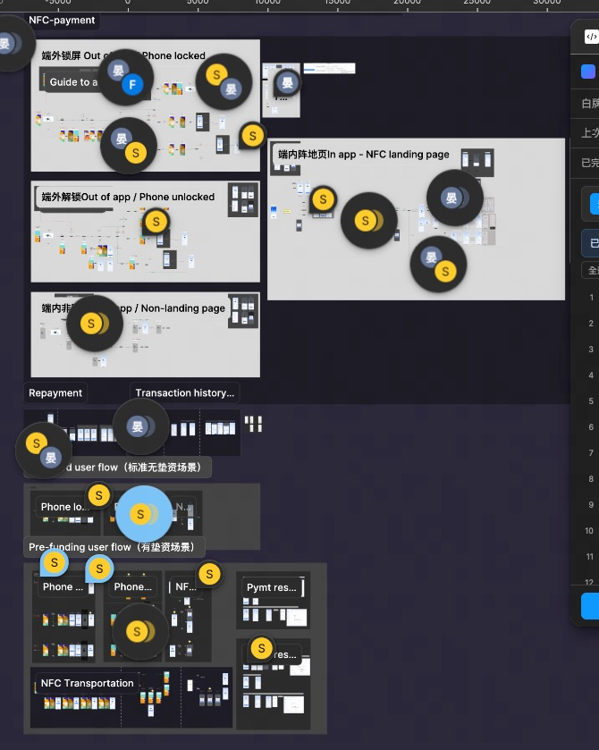
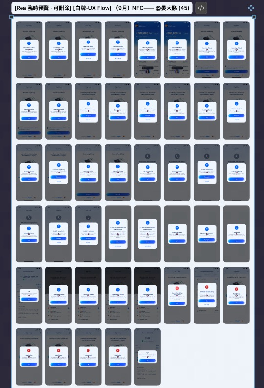
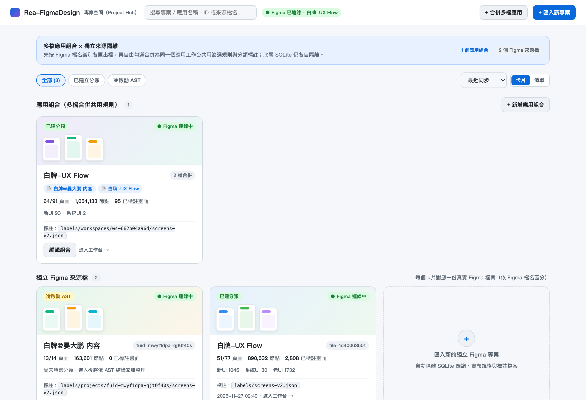
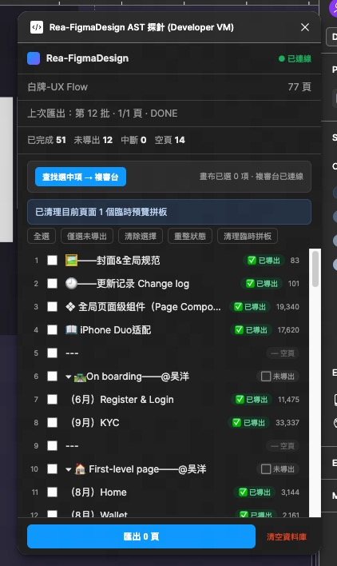
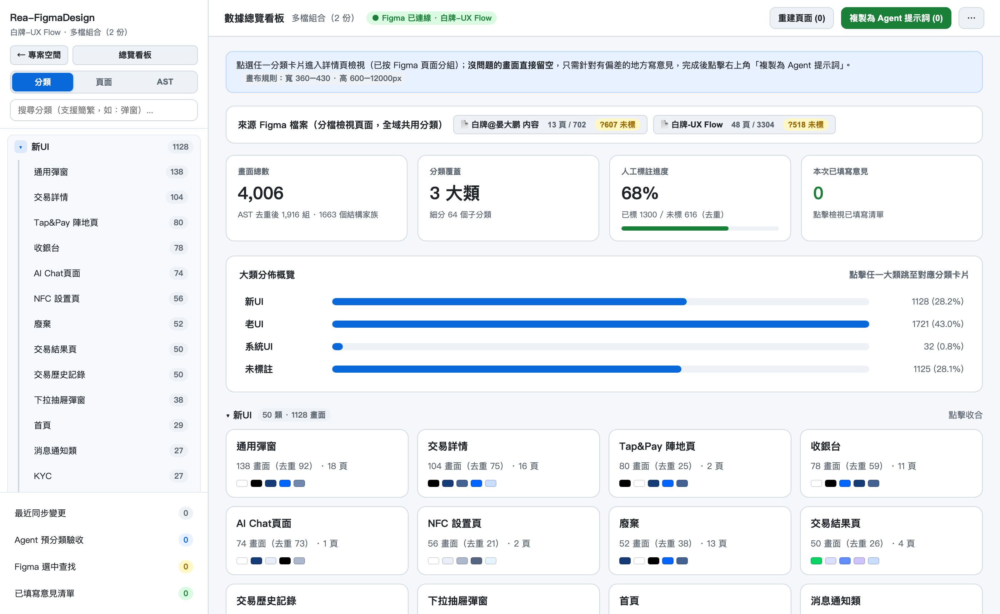
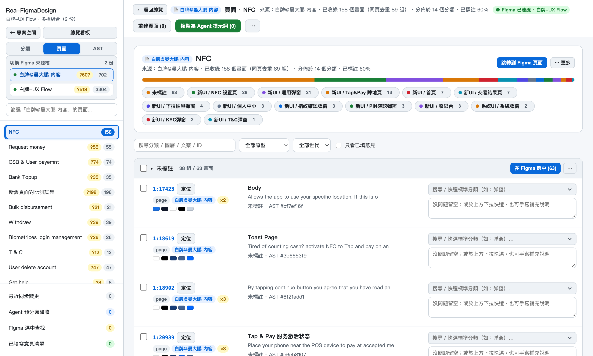
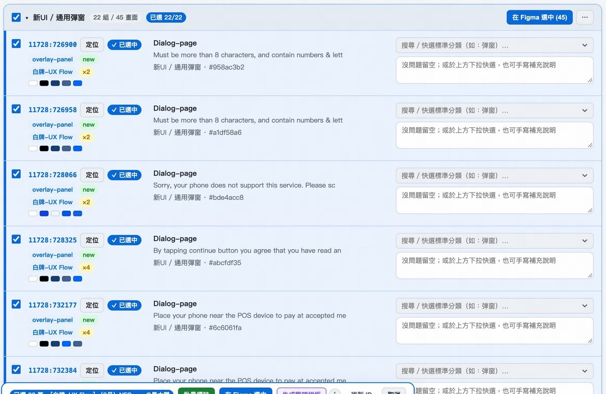
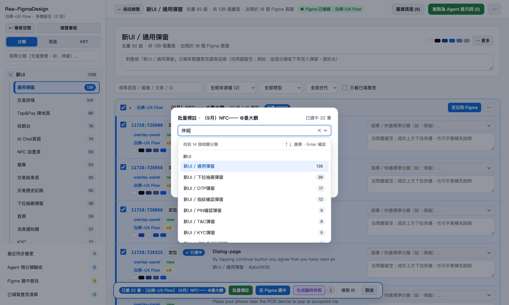
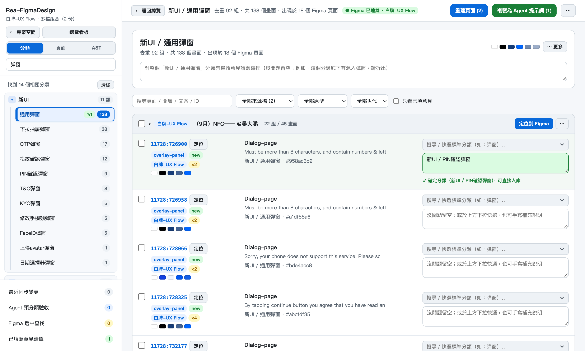

<p align="center">
  
</p>

<h3 align="center">把幾千張散落的 Figma 畫稿，變成可秒查的本機 SQLite 圖譜與設計師整理工作台</h3>

<p align="center">
  <a href="https://yandapengh.github.io/Rea-FigmaDesign/"><strong>線上產品六幕實錄</strong></a> ·
  <a href="https://yandapengh.github.io/Rea-FigmaDesign/explainers.html"><strong>五篇底層技術圖解</strong></a> ·
  <a href="#-3-分鐘本機跑起來"><strong>3 分鐘本機啟動</strong></a> ·
  <code>100% 本機零上傳</code> ·
  <code>16 MCP Tools</code> ·
  <code>MIT License</code>
</p>

---

## 為什麼需要 Rea-FigmaDesign？

真實業務產品的 Figma 設計檔常常是設計師的惡夢：**僅單份主檔就有 77 個 Pages、89 萬個節點**；合併關聯迭代檔後，多達 **91 頁、4,006 張畫面、105 萬+ 節點**。

當你需要「找出全產品一共有幾種彈窗」「清點哪些還在用老 UI、哪些是廢棄稿」或「把某幾頁改版重新對表」時，純人工只能在多份檔案之間來回縮放、截圖拼板、手寫試算表——**一輪盤點動輒耗時 3–5 天，而且只要隔天改了一頁設計稿，整份資產表就立刻過期。**

**Rea-FigmaDesign 透過「Figma 雙執行緒插件 → 本機 SQLite AST 圖譜 → 雙向複審工作台 × 16-Tool AI Agent MCP」把設計稿治理變成可計算、可追溯、可增量同步的工程化閉環：**

<table>
  <tr>
    <th width="50%">整理前：真實 Figma 畫布實景（NFC-payment）</th>
    <th width="50%">治理後：一鍵排入「臨時拼板」的 45 張彈窗</th>
  </tr>
  <tr>
    <td></td>
    <td></td>
  </tr>
  <tr>
    <td>設計稿按開發流程分散在數十頁與上百個 Section 中，同名彈窗散落各處、複本反覆出現。</td>
    <td>在工作台勾選同類畫面一鍵排齊預覽；肉眼挑出問題副本後 <strong>1:1 鎖定回原頁原稿 ID</strong>，看完刪除零殘留。</td>
  </tr>
</table>

### 真實產品實測數字（兩份關聯 Figma 檔 · 91 Pages）

| 指標 | 純人工整理 | Rea-FigmaDesign |
|---|---|---|
| **需人工檢查的畫面量** | `4,006` 張全部肉眼翻看 | AST 結構去重收斂至 **`1,916` 組（-52%）** |
| **設計改版後維護成本** | 增刪頁後表格失準，整份重對 | 插件只勾改動的那 `1` 頁，**`< 3` 分鐘增量同步** |
| **數據安全與原檔影響** | 手動建表／拉圖易遺漏或搬亂圖層 | **100% 留在本機 SQLite**，不修改任何雲端原稿 |
| **AI Agent 查詢能力** | LLM 看不清幾千張大圖，容易幻覺 | **16 個確定性 MCP 工具**，每筆結論都帶真實 Node ID |

---

## 設計師真實旅程：4 步看懂怎麼用

### 1. 不強迫合併 Figma 原檔，在專案空間自由組合多檔
團隊照常把主流程檔（`白牌-UX Flow`）與迭代檔拆開維護。在 Rea 的 **Project Hub** 直接勾選多份來源檔組成同一套應用規範，底層 SQLite 仍各自隔離，跨檔以 `sourceId::nodeId` 複合鍵防止碰撞。



### 2. 插件一鍵抽本地圖譜，先砍掉 52% 重複再照出 61.7% 歷史債
打開 Figma 插件勾選全檔或指定頁面抽出結構樹（不存向量路徑、只抽骨架與關鍵樣式），工作台總覽看板立刻攤開結構重複數與「新UI／老UI／系統UI／未標註」分佈。

<table>
  <tr>
    <th width="34%">Figma 插件端：AST 探針（77 頁）</th>
    <th width="66%">工作台總覽：4,006 畫面自動去重為 1,916 組</th>
  </tr>
  <tr>
    <td></td>
    <td></td>
  </tr>
</table>

### 3. 「頁面」按來源檔獨立排查 × 一鍵「生成臨時拼板」1:1 回原稿
切到左側 **頁面** 分頁可嚴格區分各份 Figma 檔案、逐頁清空黃色 `?N` 未標待辦；需要人眼視覺比對時，勾選目標群組按底部 **生成臨時拼板**，在 Figma 畫布排齊檢視後框選異常項，點擊插件 **「查找選中項 → 複審台」** 即刻跳回原稿卡片。

<table>
  <tr>
    <th width="50%">左側「頁面」分檔切分＋未標待辦計數</th>
    <th width="50%">全選 22 組（45 畫面）一鍵送出臨時拼板</th>
  </tr>
  <tr>
    <td></td>
    <td></td>
  </tr>
</table>

### 4. 輸簡體 `弹窗` 搜繁體分類，一路累積確認、最後一次「重建頁面」
支援簡繁雙向正規化與多詞過濾：輸入 `弹窗` 瞬間展開 `新UI / 通用彈窗`、`PIN確認彈窗`、`老UI / 通用彈窗` 等全部細類；批標確認後亮出綠框累積不中斷逛頁，最後按右上角 **「重建頁面 (N)」** 統一寫入 `screens-v2.json`。日後某頁改版或刪稿，插件僅重導該頁，自動突顯 `+NEW` 新畫面並將已刪舊標註安全歸檔至 `archivedDeleted`。

<table>
  <tr>
    <th width="50%">批量標註輸入「弹窗」即時展開繁體標準分類</th>
    <th width="50%">單卡綠框累積待寫入 ＋ 頂部一鍵「重建頁面」</th>
  </tr>
  <tr>
    <td></td>
    <td></td>
  </tr>
</table>

---

## 為什麼同時對 AI Agent（MCP）與工程團隊友好？

Figma 檔案動輒數百 MB、數十萬節點，讓 LLM 直接看截圖或掃整棵 JSON 必定失真。Rea-FigmaDesign 在資料層先用**確定性演算法**算好所有結構關係，再透過 **16 個 MCP 工具**暴露給 Agent 查詢與受控寫入：

| 層級 | 原理與產出 | 解決的問題 |
|---|---|---|
| **結構身分證** | Merkle structural hash over `(type, ordered children)` | 無視圖層改名與座標搬移，相同結構自動同組 |
| **版面原型** | Z-order 遮罩＋面板面積規則 (`page` / `overlay-panel` / `overlay`) | 精準區分帶面板彈窗與純遮罩頁（人工抽檢 10/10 一致） |
| **風格指紋** | 色票、字階、圓角、陰影與 Token 採用率 | 輔助區分新舊 UI 世代，無把握項目一律回 `unknown` |
| **雙向安全寫入** | `apply_labels` / `configure_project` 強制 `dryRun` + `confirm: true` | 確保所有自動化寫入先對照影響清單再落盤 |

> 完整原理見五篇深入圖解：**[docs/explainers.html](https://yandapengh.github.io/Rea-FigmaDesign/explainers.html)**

---

## ⚡ 3 分鐘本機跑起來

環境需求：**Node.js ≥ 20**、**Figma Desktop**（無需任何雲端資料庫或外部 API Key）。

```bash
git clone https://github.com/yandapengh/Rea-FigmaDesign.git
cd Rea-FigmaDesign
npm install

# 1. 啟動本機熱重載圖譜與雙向中繼服務（監聽 127.0.0.1:8765）
npm run start:server

# 2. 建置 Figma 插件，並在 Figma Desktop 匯入 plugin/manifest.json
#    Plugins → Development → Import plugin from manifest… → 選擇匯出整檔或單頁
npm run build:plugin

# 3. 開啟複審工作台（Project Hub → 單檔或自由合併多檔應用組合）
open http://127.0.0.1:8765/review
```

<details>
<summary><strong>開發者參考：三個查詢入口、驗證測試套件與文件索引</strong></summary>

### 三個入口，共用同一個核心（`server/core/`）
| 入口 | 給誰 | 特性 |
|---|---|---|
| `npm run query -- <cmd>` | 開發者 / CI | 唯讀、`--json`、錯誤帶固定 error code（與 core 輸出逐位元一致） |
| `npm run mcp` | 任何支援 MCP 的 AI Agent | stdio JSON-RPC，**16 個工具**含嚴格 JSON Schema 與註解標記 |
| `npm run review:board` | 設計師 | 本地離線／即時連線複審工作台（生成於 `.scratch/`） |

- **DSH Skill**：內建於 `.dsh/skills/rea-figma-design/SKILL.md`，可執行 `npm run skill:install` 同步到 `~/.dsh/skills` 跨專案使用（操作手冊見 [docs/SKILL.md](docs/SKILL.md)）。
- **Figma manifest 說明**：插件只白名單 `localhost:8765`；若 Figma 拒絕現有 `id`，於 Figma 建立 New Plugin 貼回 `plugin/manifest.json` 的 `id` 重新 `npm run build:plugin` 即可。

### 常用檢查與測試
```bash
npm run typecheck         # TypeScript 嚴格檢查
npm run test:core         # 核心演算法（去重、洋蔥雜湊、簡繁搜尋等）
npm run test:mcp          # 16 個 MCP 工具契約、enum 與破壞性寫入閘門驗證
npm run test:workspaces   # 多檔應用組合隔離與複合鍵測試
npm run test:bridge       # Figma ↔ 工作台雙向選中與臨時拼板中繼測試
npm run test:pages        # 單頁增量同步、刪稿歸檔與平滑遷移測試
npm run test:parity       # CLI 與 core JSON 輸出逐位元比對
npm run doctor            # 環境、資料庫與腳本全面健檢
```

### 延伸架構文件
- [docs/index.html](docs/index.html) — 設計師旅程六幕實錄（線上：[GitHub Pages](https://yandapengh.github.io/Rea-FigmaDesign/)）
- [docs/explainers.html](docs/explainers.html) — 五篇工程原理導讀（圖譜概念 / Merkle Hash / 數據脫水 / 真實查詢對話 / MCP 四道閘門）
- [docs/ARCHITECTURE.md](docs/ARCHITECTURE.md) — 分層架構、雙沙箱約束與資料契約
- [docs/DECISIONS.md](docs/DECISIONS.md) — 關鍵設計決策與取捨紀錄
- [docs/VALIDATION.md](docs/VALIDATION.md) — 驗證基準與冷啟動對帳流程
- [docs/QUERY.md](docs/QUERY.md) — CLI 與 MCP 16 工具詳細契約

</details>

---

## License

MIT
