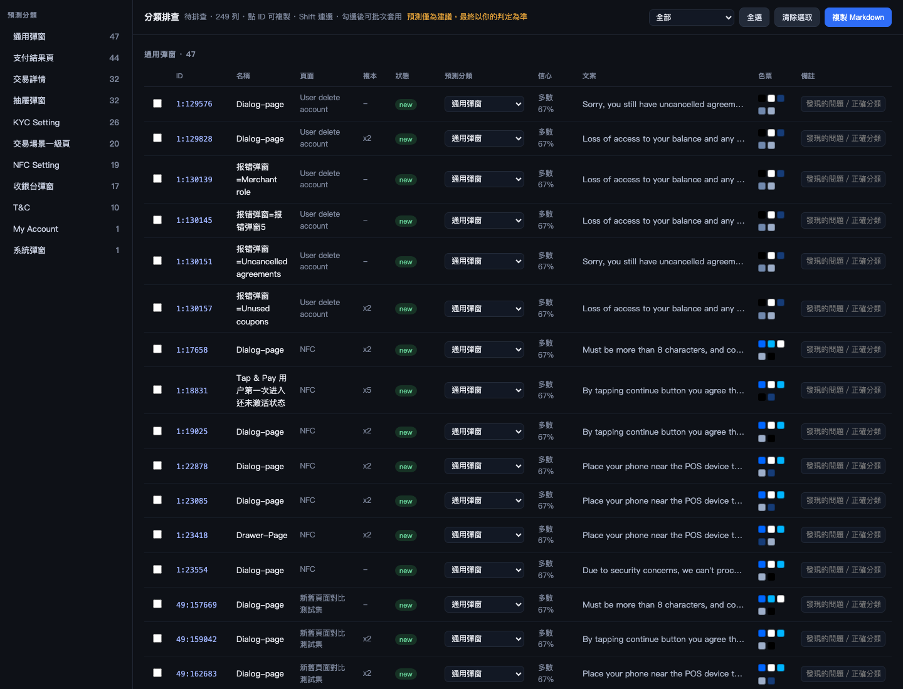

# Rea-FigmaDesign

> 把 Figma 檔案的 AST 抽成本地 SQLite 圖譜，讓設計師用 ID 與分類複審、讓 agent 直接查詢。

**線上閱讀**：https://yandapengh.github.io/Rea-FigmaDesign/



**為什麼做這個**：一份跑了兩年的支付設計檔有 163,601 個節點、512 個手機畫面，去重後只有 291 個是真的；設計師常用的名稱只有 27 種，背後卻有 68 種不同結構。Figma 擅長「畫」，不擅長「查」。

這個專案只做一次抽取，之後所有問題都問本地圖譜——不再翻頁、不再靠圖層名稱、不再人工比對。

→ 完整背景、實驗方法與技術取捨：**[docs/index.html](docs/index.html)**（Part 1 為什麼做 / Part 2 怎麼做）

---

## 能力

| 能力 | 怎麼算 |
|---|---|
| 結構家族 | 節點身份 = Merkle hash over `(type, ordered children)`，改名、複製都不影響 |
| 風格指紋 | 色票、字階、圓角、陰影、token 採用率的量化分佈 |
| 三層召回 | 同構（hash 相等）→ 近構（型別分布 cosine ≥ 0.9）→ 樣式近（≥ 0.45） |
| 新舊世代分類 | 由人工標註驅動，低信心一律回 `unknown`，不硬猜 |
| 版面原型 | 用 z-order 遮罩規則判斷 page / overlay-panel / overlay |
| 複審看板 | 設計師勾選 → 批次分類／備註 → 複製 Markdown → agent 寫回 |

## Quick start

需求：Node.js ≥ 20、Figma Desktop。

```bash
npm install

# 1. 起 ingestion server（自動建立 data/rea-figma.sqlite）
npm run start:server

# 2. 建置插件
npm run build:plugin
#    Figma → Plugins → Development → Import plugin from manifest…
#    → plugin/manifest.json → 執行 → Extract AST to Local SQLite

# 3. 檢查環境與資料
npm run doctor
npm run audit:db -- ./data/rea-figma.sqlite

# 4. 查詢
npm run query -- sheet <node-id>
npm run query -- find <node-id> --top 8
npm run sync            # 特徵表 → 預測 → 複審看板 → parity → 來源檢查
```

兩個 Figma 匯入的注意事項：

- manifest 只白名單 `http://localhost:8765` / `ws://localhost:8765`（Figma 不接受 IP 字面值），server 本身只綁 `127.0.0.1`。
- 若 Figma 拒絕 manifest 的 `id`，用 **New Plugin** 生成新 ID 貼回 `plugin/manifest.json` 再建置。

## 三個入口，一個核心

| 入口 | 給誰 | 特性 |
|---|---|---|
| `npm run query -- <cmd>` | 開發者 / CI | 唯讀、`--json`、錯誤有 code |
| `npm run mcp` | 其他 agent | stdio JSON-RPC，11 個工具 |
| `/rea-figma-review` | 設計師（DSH） | 斜線命令，零 token、直接開看板 |

三者都只做參數解析與排版；所有計算在 `server/core/`。`npm run test:parity` 會把 CLI 的 JSON 輸出與 core 逐位元比對。

## 設計原則

1. **能算的就不要猜**：結構用 hash、版面用規則、風格用統計。
2. **名稱不是身份**：名稱只是排序先驗與漂移訊號。
3. **不確定就回報**：`unknown` 是合法結果，硬分比不分更糟。
4. **來源可追溯**：`verify-source` 確保輸出的每個 ID 都存在於樣本。
5. **產物隔離**：所有暫存只進 `.scratch/`，`labels/` 是來源。

## 驗證

```bash
npm run doctor          # 環境、資料、labels、workspace
npm run test:pipeline   # Phase 1 端到端（不需要 Figma）
npm run test:parity     # CLI 輸出與 core 逐位元一致
npm run test:mcp        # 工具表面、schema 約束與 annotations
npm run query -- verify-source   # 每個 ID 都必須存在於樣本
```

## 文件

| 文件 | 內容 |
|---|---|
| [docs/index.html](docs/index.html) | 對外說明：背景故事、實驗方法、技術架構 |
| [docs/explainers.html](docs/explainers.html) | 深入解釋總覽（五篇導讀） |
| [docs/ARCHITECTURE.md](docs/ARCHITECTURE.md) | 分層、資料契約、模組地圖、擴充點 |
| [docs/DECISIONS.md](docs/DECISIONS.md) | 12 條設計決定的理由與代價 |
| [docs/VALIDATION.md](docs/VALIDATION.md) | 驗證方法：實地抽查、留一驗證、四道 gate、冷啟動 |
| [docs/SAMPLES.md](docs/SAMPLES.md) | 凍結樣本 manifest 與 sha256（不含 sqlite） |
| [docs/QUERY.md](docs/QUERY.md) | 命令契約與 DSH／MCP 註冊方式 |
| [docs/SKILL.md](docs/SKILL.md) | agent 操作規範（鐵律、流程契約、停止條件） |
| [PLAN.md](PLAN.md) | 驗收門檻、變更邊界、已知缺陷 |

## 已知限制

- 沒有縮圖：複審看板用色票／型別比例／文案當視覺替代。
- kNN 分類留一驗證 57%：只有全票（86%）可作建議。
- `pages` 目錄可能過期：查詢層一律從 `nodes.page_name` 聚合。
- 語意分類需人工命名：工具給候選群，不給名字。

## License

MIT
