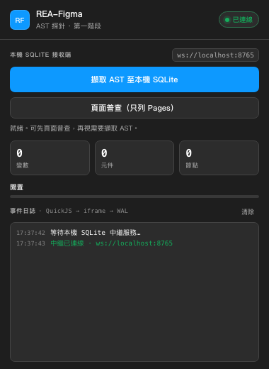
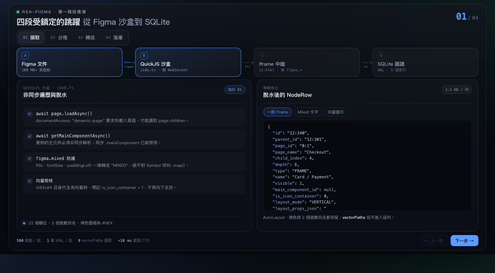

# Rea-FigmaDesign 第一階段：使用與驗收說明

> **介面語言**：繁體中文（Figma 外掛、互動架構圖、Figma 完成通知）  
> **實測環境**：macOS + Node.js 24.17.0 + Figma Desktop  
> **工程契約**：[PLAN.md](PLAN.md)｜英文技術摘要：[README.md](README.md)

---

## 0. 最快驗收（3 分鐘）

在專案根目錄執行：

```bash
cd /Users/hyd/Documents/rea-figma
npm install
npm run test:pipeline
```

看到這一行就代表協議、SQLite 建表、WAL 交易與查詢延遲全部通過：

```text
RESULT: PASS — pipeline, ACK durability, schema and query budget verified.
```

再建置外掛：

```bash
npm run build:plugin
```

確認 `plugin/dist/code.js` 存在（約 18 KB）。接著在 Figma Desktop 匯入 `plugin/manifest.json`，按介面上的 **「擷取 AST 至本機 SQLite」**，看到 **「完成 · N 個節點」** 即完成真機驗收。

---

## 1. 這個工具在做什麼

把 Figma 的圖層樹脫水成扁平節點，經由本機 WebSocket 寫入 SQLite，供後續查詢與 Phase 2 工具使用。

| 元件 | 執行環境 | 負責 |
| --- | --- | --- |
| [code.ts](plugin/src/code.ts) | Figma QuickJS 沙盒 | 非同步遍歷頁面、實例、變數；脫水與分塊 |
| [ui.html](plugin/ui.html) | Figma iframe | 接收 postMessage，透過 WebSocket 轉送 |
| [ws-server.ts](server/ws-server.ts) | Node.js | 接收分塊、回傳 ACK、協調寫入 |
| [db.ts](server/db.ts) | Node.js + better-sqlite3 | WAL 交易、預編譯批次寫入、索引 |
| 產出 | `./data/rea-figma.sqlite` | 節點、變數、元件圖譜 |

資料只會流向 `localhost:8765`（伺服器綁定 `127.0.0.1`），不會上傳到任何雲端服務。

---

## 2. 安裝與啟動

### 2.1 安裝依賴

```bash
cd /Users/hyd/Documents/rea-figma
npm install
```

需要 Node.js 20 以上（本次以 24.17.0 實測）。若 `better-sqlite3` 原生模組載入失敗：

```bash
npm rebuild better-sqlite3
```

### 2.2 啟動本機接收端（終端機 A）

```bash
npm run start:server
```

預期輸出：

```text
[ws] listening on ws://127.0.0.1:8765
[ws] sqlite sink: ./data/rea-figma.sqlite (WAL, synchronous=NORMAL)
```

**這個終端機請保持開啟。** 資料庫會建立在專案的 `data/` 目錄；server 會自動建立目錄。

若要做小檔案 practice，可用獨立 DB，避免污染目標 DB：

```bash
REA_DB_PATH=./data/rea-figma-small.sqlite npm run start:server
```

- 連接埠固定為 `8765`
- 伺服器只綁定 `127.0.0.1`，區網其他裝置無法連入；外掛端以 `ws://localhost:8765` 連線
- 每次擷取開始都會先清空上一輪的節點、變數、元件與檔案資訊

### 2.3 建置外掛（終端機 B）

```bash
npm run build:plugin
```

預期產出 `plugin/dist/code.js`（約 18 KB）。修改 `plugin/src` 後都要重新建置，再回 Figma 重新執行外掛。

---

## 3. 匯入 Figma 並擷取

1. 開啟 Figma Desktop，進入任意設計檔（建議先建立測試檔）。
2. 選擇 **Plugins → Development → Import plugin from manifest…**。
3. 選擇 `plugin/manifest.json`。
4. 在 **Plugins → Development** 看到 **「Rea-FigmaDesign AST 探針」**。
5. 執行外掛，等待狀態徽章變成綠色 **「已連線」**。
6. 按下 **「擷取 AST 至本機 SQLite」**。
7. 完成時進度顯示 **「完成 · N 個節點」**，日誌出現 **「擷取完成」**，Figma 右下角出現中文通知。

> **Manifest 修正**：Figma 的 `devAllowedDomains` 不接受 `127.0.0.1` 這類 IP 字面值。本版已改為 `http://localhost:8765` 與 `ws://localhost:8765`；伺服器仍只綁定 `127.0.0.1`。若你先前匯入過舊版，請先移除舊的開發外掛，再重新 Import，Figma 才會讀到新 manifest。

> 每個檔案只保留最後一次擷取結果；重新擷取會先清空資料表。

---

## 4. 中文介面導覽



| 介面元件 | 顯示文字 | 說明 |
| --- | --- | --- |
| 狀態徽章 | **連線中**（黃）→ **已連線**（綠） | 與本機 `ws://localhost:8765` 的連線狀態 |
| 狀態徽章 | **離線** / **X 秒後重試** | 接收端未啟動或斷線，會自動重連 |
| 主按鈕 | **擷取 AST 至本機 SQLite** | 連線成功後才啟用 |
| 主按鈕（執行中） | **正在擷取 AST…** | 反灰並顯示轉圈動畫 |
| 統計卡 | **變數 / 元件 / 節點** | 已接收的分塊列數，即時累加 |
| 進度 | **閒置 → 正在要求文件… → 擷取中… → 完成 · N 個節點** | 資料遺失時顯示 **不完整，請查看事件日誌** |
| 事件日誌 | **事件日誌** | 連線、同步開始、每 5,000 節點、完成、錯誤 |
| 清除 | **清除** | 只清畫面日誌，不動資料庫 |

### 狀態判斷

| 畫面狀態 | 意義 | 下一步 |
| --- | --- | --- |
| 綠色「已連線」、按鈕可用 | 中繼正常 | 可以擷取 |
| 灰色「離線」、提示 `請先啟動本機服務：npm run start:server` | 接收端未啟動 | 回終端機 A 啟動 |
| 日誌出現 **「伺服器拒絕 …」** | 寫入或格式驗證失敗 | 看終端機 A 的錯誤 |
| 進度顯示 **「不完整」** | 掉包或伺服器拒絕分塊 | 資料庫可能是半成品，修正後重跑 |
| 進度顯示 **「完成」** | 所有分塊已提交 | 進行資料庫驗收 |

---

## 5. 終端機驗收

| # | 指令 | 通過條件 |
| --- | --- | --- |
| 1 | `npx tsc --noEmit shared/protocol.ts` | 無錯誤、exit code 0 |
| 2 | `npx tsc --noEmit server/db.ts server/ws-server.ts` | 無錯誤、exit code 0 |
| 3 | `npm run build:plugin && test -s plugin/dist/code.js` | exit code 0，bundle 非空 |
| 4 | `npm run typecheck` | 全專案嚴格型別檢查通過 |
| 5 | `npm run test:pipeline` | 全部勾選、RESULT: PASS、exit code 0 |

測試會建立 `data/test-rea-figma.sqlite`、驗證資料、量測遞迴 CTE，最後刪除資料庫與 WAL/SHM。若想保留測試檔：

```bash
KEEP_TEST_DB=1 npm run test:pipeline
```

本次實測：

```text
streamed 7 frames in 24.0 ms
variables = 10 · components = 5 · nodes = 1500
recursive CTE: avg 0.636 ms / max 0.976 ms (< 10 ms)
sqlite file: 688.0 KB (< 2 MB)
journal_mode = wal
```

---

## 6. Figma 真機驗收清單

- [ ] 終端機 A 顯示 `[ws] listening on ws://127.0.0.1:8765`，且沒有錯誤。
- [ ] 外掛標題列顯示 **「AST 探針 · 第一階段」**。
- [ ] 狀態徽章在一秒內變成綠色 **「已連線」**。
- [ ] 主按鈕可點，文字為 **「擷取 AST 至本機 SQLite」**。
- [ ] 點擊後三個統計數字開始增加。
- [ ] 進度依序經過 **「正在要求文件…」**、**「擷取中…」**，最後變成 **「完成」**。
- [ ] 日誌沒有紅色的 **「不完整」** 或 **「伺服器拒絕」**。
- [ ] 專案 `data/` 目錄出現 `rea-figma.sqlite`。
- [ ] 第 7 節查詢的 `nodes` 數量與畫面統計一致。
- [ ] Figma 右下角出現中文完成通知。

---

## 7. 資料庫驗收

確認檔案與資料表：

```bash
ls -lh data/rea-figma.sqlite
sqlite3 data/rea-figma.sqlite ".tables"
```

應看到 `file_meta`、`variables`、`components`、`nodes` 四張表。基本數量：

```bash
sqlite3 data/rea-figma.sqlite "SELECT COUNT(*) AS nodes FROM nodes;"
sqlite3 data/rea-figma.sqlite "SELECT COUNT(*) AS variables FROM variables;"
sqlite3 data/rea-figma.sqlite "SELECT COUNT(*) AS components FROM components;"
```

沒有 `sqlite3` 指令時，可用 Node.js：

```bash
node -e "const D=require('better-sqlite3');const db=new D('data/rea-figma.sqlite',{readonly:true});console.log(db.prepare('SELECT COUNT(*) AS nodes FROM nodes').get());db.close();"
```

### 7.1 資料品質檢查

```sql
-- 各圖層類型占比
SELECT type, COUNT(*) AS n FROM nodes GROUP BY type ORDER BY n DESC;

-- 被標記為圖示容器、已剪枝的節點
SELECT COUNT(*) AS icons FROM nodes WHERE is_icon_container = 1;

-- 含 MIXED 字型的文字節點
SELECT COUNT(*) AS mixed_text FROM nodes WHERE text_style_json LIKE '%"MIXED"%';

-- 保留 VARIABLE_ALIAS 的變數
SELECT name, resolved_type, values_by_mode_json
FROM variables
WHERE values_by_mode_json LIKE '%VARIABLE_ALIAS%';

-- 孤兒節點檢查（正常應為 0）
SELECT COUNT(*) AS orphans
FROM nodes n
LEFT JOIN nodes p ON n.parent_id = p.id
WHERE n.parent_id IS NOT NULL AND p.id IS NULL;
```

### 7.2 遞迴子樹查詢

```sql
WITH RECURSIVE subtree(id) AS (
  SELECT id FROM nodes WHERE parent_id IS NULL
  UNION ALL
  SELECT n.id FROM nodes n JOIN subtree s ON n.parent_id = s.id
)
SELECT COUNT(*) AS nodes_in_tree FROM subtree;
```

### 7.3 SQLite 的 -wal / -shm 是什麼

- `rea-figma.sqlite`：主資料庫檔。
- `rea-figma.sqlite-wal`：write-ahead log。已提交但還沒 checkpoint 回主檔的頁面先放在這裡；不是備份檔。
- `rea-figma.sqlite-shm`：WAL 的共享記憶體索引，讓多個 SQLite 連線協調讀寫。
- 三個檔是一組。server 執行中不要只搬主檔或刪 WAL/SHM；先正常停止 server，再一起備份或搬移。
- 正常關閉後 WAL 可能變成 0 bytes、SHM 可能還在，這是正常的；資料已合併回主檔。
- 本專案把它們統一放在 `data/`，`.gitignore` 已排除，不會進 git。

---

## 8. 常見問題

| 現象 | 可能原因 | 處理方式 |
| --- | --- | --- |
| 徽章一直「連線中」或「離線」 | 接收端未啟動、連接埠被占用、防火牆 | 確認終端機 A 有 listening；用 `lsof -i :8765`（macOS/Linux）或 `netstat -ano`（Windows）檢查 |
| 按鈕灰色不能按 | 尚未連線，或正在擷取 | 等徽章變「已連線」；執行中請等完成 |
| Figma 匯入出現 invalid value for devAllowedDomains | devAllowedDomains 使用了 `127.0.0.1` 這類 IP 字面值 | 本版已改為 `http://localhost:8765` 與 `ws://localhost:8765`；移除舊外掛後重新 Import |
| Figma 匯入出現 Plugin ID error | 目前使用本機字串 ID | 用 **Plugins → Development → New Plugin** 產生數字 ID，貼進 `plugin/manifest.json` 的 `id`，重新匯入 |
| 擷取到一半顯示「不完整」 | 掉包、伺服器拒絕、接收端被關閉 | 看事件日誌與終端機 A；修正後重跑 |
| better-sqlite3 載入失敗或 NODE_MODULE_VERSION 不符 | Node.js 版本與原生模組不一致 | 使用 Node 20+，執行 `npm rebuild better-sqlite3` |
| npx tsc 出現 TS5112 | 升級到 TypeScript 7 | 本專案鎖定 5.9.3：`npm install -D typescript@5.9.3` |
| 找不到 data/rea-figma.sqlite | 預設路徑是 `./data/rea-figma.sqlite`，或 server 啟動目錄不同 | 確認專案 `data/` 目錄存在且可寫；必要時用 `REA_DB_PATH` 指定 |
| 瀏覽器版 Figma 無法連線 | 瀏覽器可能封鎖本機 ws:// | 改用 Figma Desktop |
| 大型檔案擷取很久 | 節點多、實例解析多 | 正常現象；觀察每 5,000 節點日誌，必要時縮小測試檔 |
| 通知出現英文錯誤 | 錯誤原文來自 Figma API | 介面會加中文前綴「擷取失敗：」，可把整段訊息貼回排查 |

---

## 9. 限制與注意事項

- **變數別名只保留、不展開**：values_by_mode_json 會保留 VARIABLE_ALIAS 與 id，不會自動解析成最終色值。
- **實例子樹會一併記錄**：方便分析 override，因此節點數可能比只看主元件多。
- **100 MB / 5 秒是設計目標**：目前自動化測試證明協議、WAL 吞吐與查詢預算，尚未用真實 100 MB Figma 檔做端到端計時。
- **中斷即為半成品**：傳輸中斷時資料庫可能只寫入部分分塊；介面會顯示「不完整」，請修正後重跑。
- **Phase 1 連線參數**：連接埠 8765；資料庫預設 ./data/rea-figma.sqlite，可用 REA_DB_PATH 覆寫。
- **不讀取向量幾何**：vectorPaths / vectorNetwork 永遠不會進入資料庫；圖示只保留容器列。
- **開發版外掛**：devAllowedDomains 只在開發匯入時生效，且只使用 `localhost`（Figma 不接受 `127.0.0.1`）；若要發佈到社群，需另外設定網路白名單與正式 Plugin ID。

---

## 10. 檔案位置與實測結果

| 檔案 | 用途 |
| --- | --- |
| [plugin/manifest.json](plugin/manifest.json) | Figma 外掛設定（dynamic-page、本機 WebSocket 白名單） |
| [plugin/ui.html](plugin/ui.html) | 380×520 中文介面、WebSocket 中繼、進度與日誌 |
| [plugin/src/code.ts](plugin/src/code.ts) | QuickJS 沙盒遍歷、變數／頁面／實例擷取 |
| [plugin/src/serializer.ts](plugin/src/serializer.ts) | mixed 防護、顏色 hex、圖示剪枝、NodeRow |
| [server/ws-server.ts](server/ws-server.ts) | 綁定 127.0.0.1:8765 的接收端；外掛以 localhost 連線 |
| [server/db.ts](server/db.ts) | SQLite schema、WAL、批次交易 |
| [server/verify-mock.ts](server/verify-mock.ts) | 無頭端到端測試 |
| [shared/protocol.ts](shared/protocol.ts) | 共用訊息與資料列型別 |
| [docs/architecture-widget.html](docs/architecture-widget.html) | 可互動的四階段架構推演 |
| [PLAN.md](PLAN.md) | 工程邊界與驗收契約 |

| 項目 | 結果 |
| --- | --- |
| 終端機斷言 | 5 / 5 通過，exit code 0 |
| 模擬 AST | 1,500 nodes、10 variables、5 components |
| 分塊 | 3 × 500 nodes，7 幀，約 24.0 ms 完成串流 |
| SQLite 大小 | 688.0 KB（< 2 MB） |
| 遞迴 CTE | 平均 0.636 ms、最大 0.976 ms（< 10 ms） |
| 外掛 bundle | 18.1 KB，沙盒 bundle 不含 new WebSocket |
| Figma 外掛介面 | 380 × 520，實測「已連線」、無溢出、無 JS 例外 |
| 架構圖 | 1,120 × 580，適配 600px 容器，中文介面可互動 |

互動架構圖可直接用瀏覽器打開，支援階段切換、樣本切換與方向鍵：



> 介面截圖皆由實際 HTML 以無頭 Edge 渲染取得，不是手繪 mockup。Figma 沙盒內的最終行為仍建議依第 6 節在 Figma Desktop 點一次確認。
